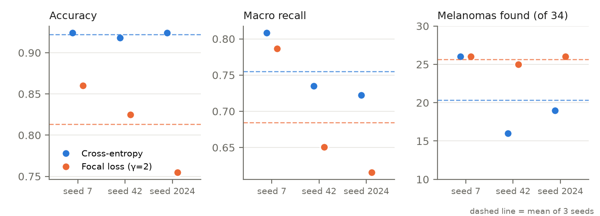
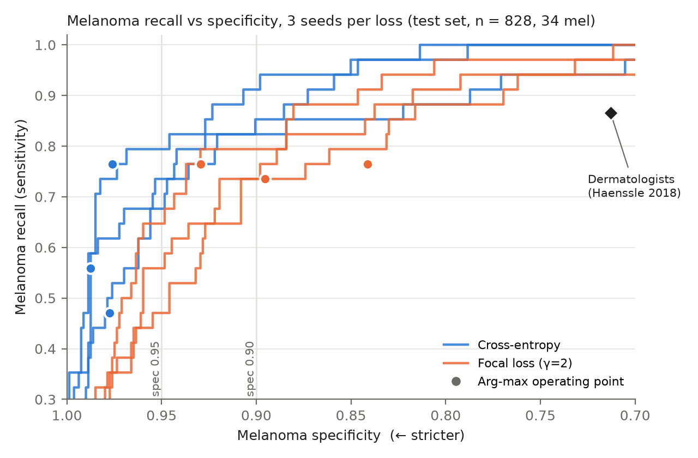

# Milestone 4: Results — Focal Loss (H1) and the Melanoma Threshold Control (H2)

**Authors:** Navnit Naman (230085), Kanhaiya Kumar (230062)  
**Base paper:** Datta et al., *Soft-Attention Improves Skin Cancer Classification Performance*, iMIMIC @ MICCAI 2021  
**Hypotheses tested:** `M3_hypothesis.md` (H1, focal loss; decision rule in its addendum) and `M3_hypothesis2_threshold.md` (H2, threshold)  
**Code:** `train.py` (training), `run_pod.sh` (one run per GPU pod), `M4_analyze.py` (every table and verdict below)

---

## 1. Summary

| | Verdict | One-line reason |
|---|---|---|
| **H1** focal loss raises melanoma recall | **Not supported.** Rejected by the §4 macro-recall criterion; *inconclusive* under the addendum's paired rule | Focal finds more melanomas (25.7 vs 20.3 per seed, pooled McNemar p = 0.011), but not on every seed (seed 7 ties). Macro recall falls (0.755 → 0.684), weighted precision falls by 0.031, and accuracy falls by 11 points. |
| **H2** a threshold alone raises baseline recall | **Supported** on all three CE seeds | Cross-fitted at specificity ≥ 0.95, CE finds 27.1, 24.4 and 23.6 of 34 melanomas (bar: 20), with weighted precision within ±0.01 and a stable threshold. |
| **H1 vs H2** | **CE + threshold beats focal loss** | At matched specificity CE finds more melanomas: 25.0 vs 19.3 per seed at spec ≥ 0.95, and 29.3 vs 25.7 at spec ≥ 0.90. CE also keeps higher melanoma AUC (0.958 vs 0.927). |

Focal loss works mainly by moving the melanoma operating point. It predicts melanoma 82–152 times (CE: 29–45) and buys recall with specificity. Once that shift is matched by a threshold on the cross-entropy model, the gain disappears and focal loss is worse. These are the outcomes we listed in M3 as *partial support at best* and *the threshold explains it*.

---

## 2. Setup (as pre-registered, with one hardware deviation)

- **Model:** Inception-ResNet-v2 baseline **without** Soft-Attention, cut at `block8_9`, as in our M2 reproduction.
- **Training:** Adam (lr 0.01, ε 0.1), batch 16, at most 150 epochs, EarlyStopping on val_loss (patience 30), checkpoint on best val_accuracy, melanoma class weight ×5. The training set was augmented offline to 51,699 images, and the authors' lesion-grouped split was used (828 test images, 34 melanomas). The test set also serves as validation (the paper's protocol, see §6).
- **The single change:** loss = `categorical_crossentropy` vs `CategoricalFocalCrossentropy(γ = 2, α = 1)`. Everything else is identical.
- **Runs:** 2 losses × seeds 42, 7, 2024 = 6 runs, one per pod. TF 2.20, NVIDIA **A40** (RunPod secure cloud). The addendum named an RTX 4090, but none was available, so all six runs used the same A40 type. 17.6 GPU-hours of training in total.

| Run | Epochs run | Best epoch | Train time (h) |
|---|---|---|---|
| CE seed 7 | 49 | 23 | 2.14 |
| CE seed 42 | 48 | 22 | 2.14 |
| CE seed 2024 | 42 | 36 | 1.81 |
| Focal seed 7 | 112 | 67 | 4.69 |
| Focal seed 42 | 95 | 65 | 3.97 |
| Focal seed 2024 | 65 | 29 | 2.86 |

Focal runs train about twice as long and pick their best checkpoint much later. Its loss values are smaller, so the same absolute `min_delta` keeps resetting early stopping. This is the step-size / convergence risk from M3 §5.

---

## 3. Results (arg-max decision, test set n = 828)

### 3.1 Per run

| Loss | Seed | Accuracy | W. precision | Macro recall | mel found | mel recall (95 % Wilson) | mel spec. | mel AUC | W. AUC | mel predicted |
|---|---|---|---|---|---|---|---|---|---|---|
| CE | 7 | 0.924 | 0.930 | 0.808 | 26/34 | 0.765 (0.60–0.88) | 0.976 | 0.951 | 0.979 | 45 |
| CE | 42 | 0.918 | 0.914 | 0.735 | 16/34 | 0.471 (0.31–0.63) | 0.977 | 0.957 | 0.984 | 34 |
| CE | 2024 | 0.924 | 0.921 | 0.722 | 19/34 | 0.559 (0.39–0.71) | 0.987 | 0.965 | 0.986 | 29 |
| Focal | 7 | 0.860 | 0.906 | 0.786 | 26/34 | 0.765 (0.60–0.88) | 0.929 | 0.943 | 0.966 | 82 |
| Focal | 42 | 0.825 | 0.887 | 0.651 | 25/34 | 0.735 (0.57–0.85) | 0.895 | 0.916 | 0.963 | 108 |
| Focal | 2024 | 0.755 | 0.878 | 0.616 | 26/34 | 0.765 (0.60–0.88) | 0.841 | 0.923 | 0.952 | 152 |

### 3.2 Mean ± std over the three seeds

| Loss | Accuracy | W. precision | Macro recall | mel recall | mel spec. | mel AUC | W. AUC |
|---|---|---|---|---|---|---|---|
| CE | **0.922 ± 0.003** | **0.922 ± 0.008** | **0.755 ± 0.046** | 0.598 ± 0.151 | **0.980 ± 0.006** | **0.958** | **0.983 ± 0.004** |
| Focal | 0.813 ± 0.054 | 0.890 ± 0.014 | 0.684 ± 0.090 | **0.755 ± 0.017** | 0.889 ± 0.044 | 0.927 | 0.961 ± 0.008 |

### 3.3 Where focal loss's errors go (correct / total, per class)

| Run | akiec | bcc | bkl | df | mel | nv | vasc |
|---|---|---|---|---|---|---|---|
| CE 7 | 18/23 | 21/26 | 44/66 | 4/6 | 26/34 | 642/663 | 10/10 |
| CE 42 | 11/23 | 21/26 | 44/66 | 5/6 | 16/34 | 654/663 | 9/10 |
| CE 2024 | 16/23 | 18/26 | 48/66 | 3/6 | 19/34 | 652/663 | 9/10 |
| Focal 7 | 14/23 | 24/26 | 38/66 | 5/6 | 26/34 | 596/663 | 9/10 |
| Focal 42 | 11/23 | 16/26 | 31/66 | 4/6 | 25/34 | 589/663 | 7/10 |
| Focal 2024 | 14/23 | 6/26 | 33/66 | 3/6 | 26/34 | 534/663 | 9/10 |

Compared with CE on the same seed, focal loss gets 46–118 more *nv* images wrong and about 11 more *bkl* images, while predicting melanoma 37–123 more times. On seed 2024 it also collapses on *bcc* (6/26). The extra melanomas cost far more errors on the other classes, which is why macro recall falls.

### 3.4 Paired test, same seed, same 828 images (exact McNemar)

| Seed | All images: only CE right / only focal right | p | Melanomas: only CE found / only focal found | p |
|---|---|---|---|---|
| 7 | 75 / 22 | < 0.001 | 1 / 1 | 1.000 |
| 42 | 104 / 27 | < 0.001 | 5 / 14 | 0.064 |
| 2024 | 161 / 21 | < 0.001 | 4 / 11 | 0.118 |
| **Pooled (102 melanomas)** | | | **10 / 26** | **0.011** |

On every seed CE is significantly more often right overall. On melanomas, focal is ahead when pooled but ties on seed 7.

*Figure 1. Each dot is one run; dashed lines are the mean over three seeds. Focal loss raises and stabilises the melanoma count but lowers accuracy and macro recall on every seed.*

---

## 4. H1 verdict under the pre-registered rules

| Criterion (written before any M4 run) | Result | Met? |
|---|---|---|
| §4: focal mean melanoma recall exceeds the CE mean by > 1 CE std | +5.3 melanomas vs CE std 5.1 | yes (barely) |
| Addendum: focal finds more melanomas on **every** seed | 26 = 26 on seed 7 | **no** |
| Addendum: pooled melanoma McNemar p < 0.05 | p = 0.011 | yes |
| §4: macro recall improves (not only through df / vasc) | 0.755 → 0.684 | **no: reject** |
| §4 / addendum: weighted precision falls by ≤ 0.02 (otherwise *partial* at best) | −0.031 | **no** |

**H1 is not supported.** Under the addendum's paired rule alone it is *inconclusive* (this is what `M4_analyze.py` prints). The §4 macro-recall criterion, also fixed in advance, rejects it outright. Even if both of those were ignored, the precision drop would cap it at *partial support*. We do not report this as a positive result.

Run-to-run variance is itself a finding. CE melanoma recall ranges from 16 to 26 of 34 across seeds with identical code. The seed sets both training randomness and which images form the 828-image test set (same class counts; the three test sets share only 12 images). CE and focal always share their seed's test set, so the paired comparisons are unaffected. So M2's single-run comparison (IRv2 15/34 vs IRv2 + SA 21/34) is within one seed's noise. Focal loss is much more stable on melanoma (25–26 of 34) but much less stable overall (accuracy 0.755–0.860).

---

## 5. H2: cross-fitted melanoma threshold

The threshold is picked on 4/5 of the test set (stratified) and applied to the remaining 1/5, repeated over 5 folds × 20 random splits. No image is scored by a threshold chosen on itself.

| Model (mean of 3 seeds) | Operating point | mel found / 34 | mel spec. | W. precision |
|---|---|---|---|---|
| CE | arg-max | 20.3 | 0.980 | 0.922 |
| CE | **spec ≥ 0.95** | **25.0** | 0.950 | 0.921 |
| CE | spec ≥ 0.90 | **29.3** | 0.899 | 0.923 |
| CE | spec ≥ 0.713 (dermatologists, sens. 0.866) | 33.3 | 0.713 | 0.939 |
| Focal | arg-max | 25.7 | 0.889 | 0.890 |
| Focal | spec ≥ 0.95 | 19.3 | 0.949 | 0.881 |
| Focal | spec ≥ 0.90 | 25.7 | 0.899 | 0.886 |
| Focal | spec ≥ 0.713 | 32.8 | 0.712 | 0.895 |

Per seed, CE at spec ≥ 0.95 finds **27.1, 24.4 and 23.6** of 34 (threshold std across folds 0.026, 0.022, 0.013), and weighted precision moves by −0.007, +0.008 and −0.002. All three H2 criteria hold on all three seeds (≥ 20 / 34, Δ precision within 0.02, threshold std < 0.2), so **H2 is supported**. The full per-seed table is in `M4_analyze.py` output §4.

*Figure 2. Melanoma recall against specificity as the melanoma threshold moves, one line per run (blue = CE, orange = focal). Dots are the default arg-max decisions. The curves are drawn on the full test set for illustration; the numbers in the table above are cross-fitted. The CE curves lie above the focal curves at almost every specificity, so focal's extra melanomas come from moving along a lower curve, not from a better one.*

**The key comparison.** Focal loss at arg-max sits at specificity 0.889. CE thresholded to specificity 0.90 finds **29.3** melanomas at that point, against focal's **25.7**, with higher weighted precision (0.923 vs 0.890). Focal loss achieves less than a zero-cost threshold on the model we already had. This matches the M3 H2 table's *Supported* row: arg-max recall alone cannot show that a loss helps.

Two cautions for H2:
- It was pre-registered on the M2 Kaggle seed-42 checkpoint (15/34), whose probabilities were not saved. It is tested here on the three new CE runs instead.
- The IRv2 + Soft-Attention arm of H2 was not run in M4.

---

## 6. Limitations

- **Test set used as validation** (paper protocol): checkpoint selection and early stopping both see the test set. This affects CE and focal equally, but all absolute numbers are optimistic.
- **34 test melanomas.** One image is 2.9 recall points. Three seeds give a rough standard deviation, which is why the paired test was added in advance.
- **Focal loss was run with the paper's optimiser settings**, tuned for cross-entropy (lr 0.01, ε 0.1). A focal-specific learning rate or a longer schedule might change the result. That would be a second variable, so it was not done here (§7).
- **Hardware:** A40 instead of the planned RTX 4090 and M2's Kaggle T4. CE seed 42 on the A40 found 16/34, close to the M2 Kaggle run's 15/34.
- Benchmark numbers on a curated research dataset. **No clinical claims.**

---

## 7. What we would do next

1. **Threshold first.** Report every model at matched specificity (or by AUC) rather than at arg-max. The M2 attention result should be re-checked this way, across seeds.
2. Retest focal loss with its own learning rate (e.g. 1e-3) and early stopping on a fixed held-out validation split, as a new, separately pre-registered hypothesis.
3. Move the evaluation to a validation split that is separate from the test set, then repeat both arms.

---

*Per-run outputs (test-set probabilities, training histories, per-class metrics, confusion matrices and curves) are in `m4_results/runs/`. Every table above is regenerated by `python M4_analyze.py m4_results/runs` (full output: `m4_results/M4_results_tables.md`); the figures by `make_m4_figures.py`. Model weights are not committed.*

**References.** Datta S. K. et al., iMIMIC @ MICCAI 2021. Lin T.-Y. et al., *Focal Loss for Dense Object Detection*, ICCV 2017. Haenssle H. A. et al., *Annals of Oncology* 29(8), 2018.
