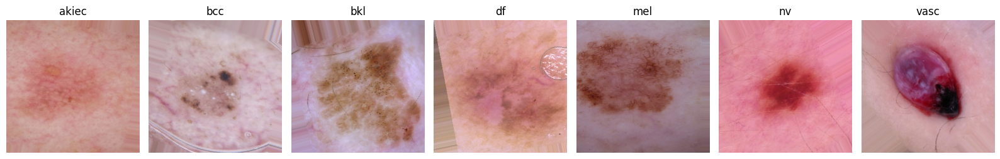
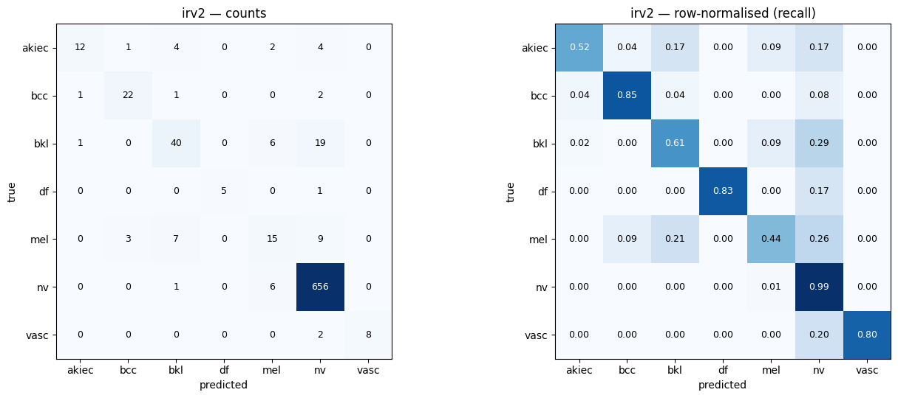
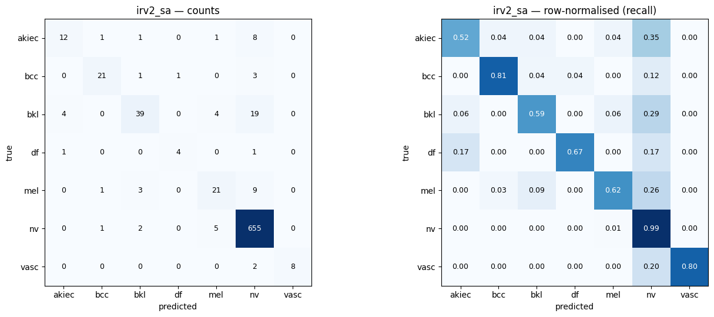
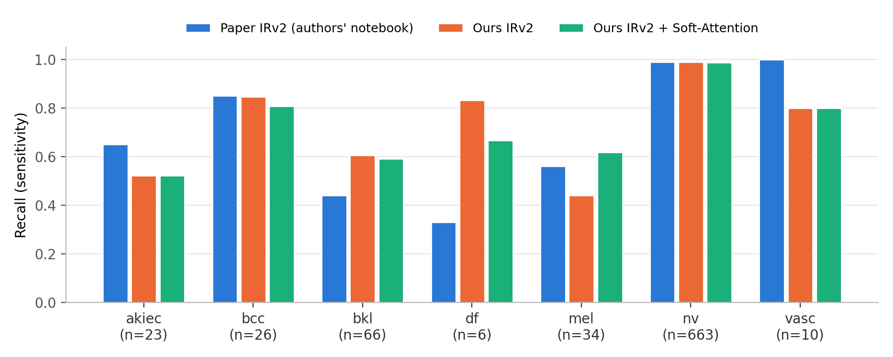
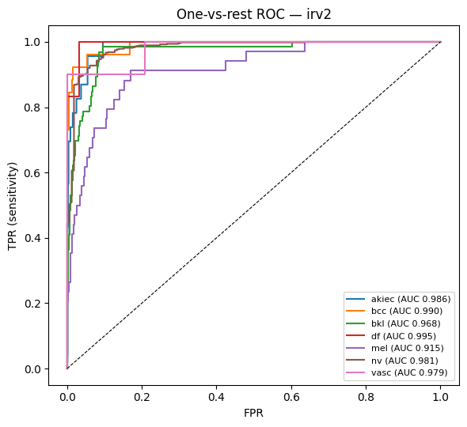
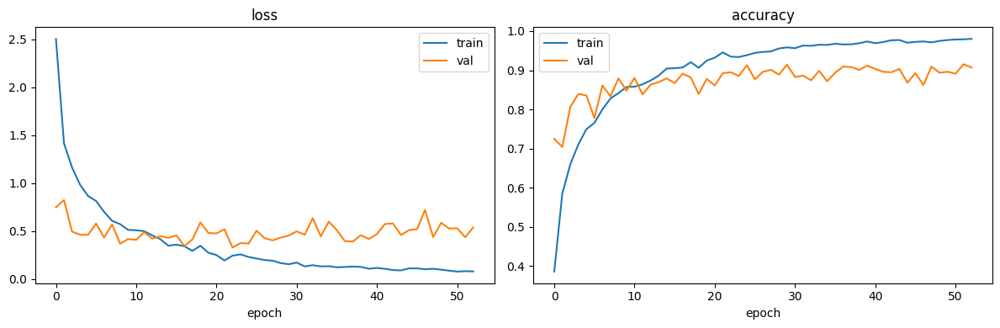
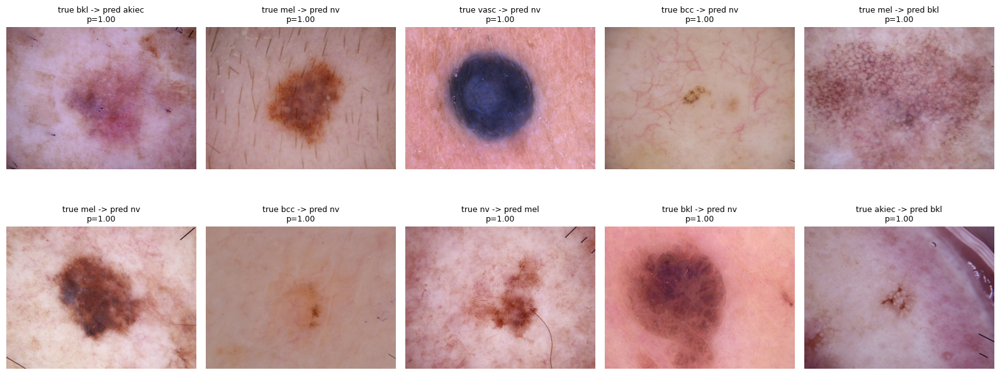
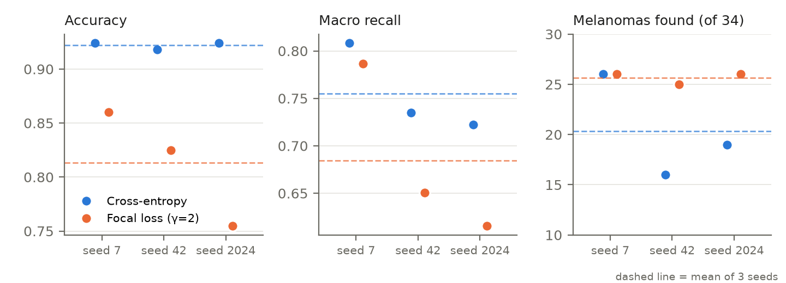
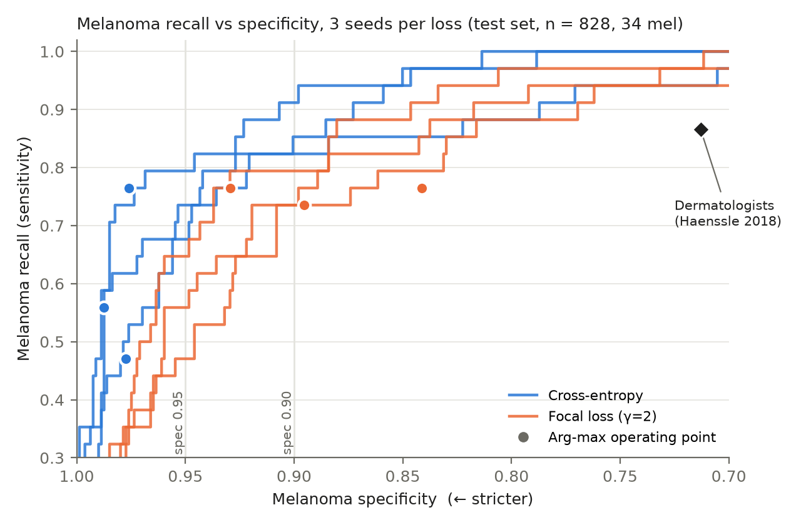

# Reproducing Soft-Attention for Skin Lesion Classification on HAM10000, and a Pre-Registered Test of Focal Loss for Melanoma Recall

**Navnit Naman** (230085) · **Kanhaiya Kumar** (230062)  
Newton School of Technology, Rishihood University

> Markdown version of the IEEE-format report. LaTeX source: [`report.tex`](report.tex) · PDF: [`report.pdf`](report.pdf)

---

## Abstract

We reproduce Datta *et al.*'s “Soft-Attention Improves Skin Cancer Classification Performance” (iMIMIC @ MICCAI 2021) on the seven-class HAM10000 benchmark and then test a hypothesis of our own. Porting the authors' code to TensorFlow 2.20, we match their split (9,187 training / 828 test images), augmentation (51,699 images) and parameter counts exactly. The Inception-ResNet-v2 (IRv2) baseline reproduces within 0.01 of the paper on accuracy, weighted precision and weighted AUC, but the claimed +3.2-point gain from Soft-Attention shrinks to +0.4 points, inside the bootstrap interval of either model. The reproduction exposes the baseline's real weakness: at 91.6% accuracy it finds only 15 of 34 test melanomas. We pre-registered two hypotheses: (H1) focal loss (γ=2) as a single change raises melanoma and macro recall; (H2) lowering the melanoma decision threshold, with no retraining, achieves the same. Six training runs (cross-entropy and focal loss, three seeds each) show that focal loss finds more melanomas (25.7 vs. 20.3 of 34; pooled McNemar p=0.011) only by predicting melanoma two to four times as often: accuracy falls from 0.922 to 0.813, macro recall from 0.755 to 0.684 and melanoma AUC from 0.958 to 0.927. H1 is therefore not supported. H2 is supported on every seed, and a cross-fitted threshold on the cross-entropy model finds more melanomas than focal loss at every matched specificity (29.3 vs. 25.7 at specificity 0.90). Run-to-run variance is large (16–26 melanomas across seeds for an identical configuration), which also puts the original attention claim within noise. No clinical claims are made.

**Index terms:** skin lesion classification, melanoma, HAM10000, reproducibility, soft attention, focal loss, decision threshold, pre-registration

---

## I. Introduction

Skin cancer is among the most commonly diagnosed cancers worldwide. Melanoma accounts for a small fraction of cases but for most skin-cancer deaths, and survival depends strongly on early detection [1]. Dermoscopy improves diagnostic accuracy, but its interpretation is subjective: in a reader study, 58 dermatologists reached a mean melanoma sensitivity of 86.6% at a specificity of 71.3% [4]. This has motivated a decade of work on automated classification, beginning with the demonstration that an ImageNet-pretrained convolutional neural network (CNN) can match dermatologists on binary tasks [1].

For multi-class classification, HAM10000 [2] is the standard public benchmark. Two of its properties make headline numbers hard to interpret. It is severely imbalanced (nevi are 66.9% of images, dermatofibroma about 1%), so accuracy-weighted metrics hide minority-class failures; and its 10,015 images show only 7,470 lesions, so splits that ignore lesion identity leak near-duplicates [12]. Several cited results do not survive these checks [13], and one has been retracted [16].

We therefore chose to *reproduce* a published result before proposing a change. Our base paper, Datta *et al.* [8], inserts a Soft-Attention module into ImageNet backbones and reports that IRv2 with Soft-Attention reaches 93.8% weighted precision, 3.2 points above the same backbone without attention. We then used what the reproduction revealed to formulate, pre-register and test a hypothesis of our own.

The project ran in four milestones: a literature review and paper selection (M1), the reproduction (M2), two pre-registered hypotheses (M3), and a multi-seed test of them (M4). Our contributions are:

1. a verified reproduction of [8], with exact agreement in split, augmented-set size and parameter counts, and an itemised list of porting changes;
2. a gap analysis showing that the claimed Soft-Attention gain cannot be distinguished from noise under the original protocol;
3. two hypotheses, focal loss (H1) and a melanoma threshold control (H2), stated with direction, magnitude, mechanism and falsification criteria before any experiment;
4. a six-run, three-seed test with paired statistics, which rejects H1, supports H2, and gives the first measurement of run-to-run variance on this pipeline;
5. all code, per-run predictions and analysis scripts, so every number here can be regenerated.

## II. Related Work

### A. Clinical benchmarks

Esteva *et al.* [1] trained a single Inception-v3 on 129,450 clinical images and matched 21 dermatologists on biopsy-proven binary tasks. Haenssle *et al.* [4] supply the human operating point (sensitivity 86.6%, specificity 71.3%), which we use as a reference. Tschandl *et al.* [7] showed that AI-assisted clinicians outperform either alone, framing such systems as decision support.

### B. Datasets and protocols

HAM10000 [2] documents its multi-source acquisition and the presence of multiple images per lesion. The ISIC 2017 challenge [3] standardised fixed partitions and balanced accuracy; the ISIC 2018 Task 3 training set *is* HAM10000.

### C. Transfer-learning baselines

Chaturvedi *et al.* [6] fine-tuned MobileNet (83.1% accuracy). Ali *et al.* [9] fine-tuned EfficientNet B0–B7; B4 was best (87.91%) and larger models did not improve on it, suggesting that capacity is not the bottleneck on HAM10000.

### D. Attention, imbalance and augmentation

Datta *et al.* [8] add Soft-Attention to five backbones; IRv2+SA is best. Yao *et al.* [10] combine RandAugment, DropBlock and class-balanced losses in a single regularised model. Perez *et al.* [5] ablated 13 augmentation scenarios, our template for one-variable ablation. Lin *et al.* [17] proposed focal loss to down-weight easy examples, the mechanism behind H1. Gessert *et al.* [11] won ISIC 2019 with a multi-resolution EfficientNet ensemble.

### E. Data quality and integrity

Abhishek *et al.* [12] documented duplicates, cross-split leakage and label noise in HAM10000 derivatives. Shetty *et al.* [13] report 95.18% on a test set built with augmentation before the split. “DenseNet-II” has been retracted [16]. Rehman *et al.* [14] and the review of Naseri and Safaei [15] confirm that CNN transfer learning remains the dominant paradigm.

## III. Problem, Dataset and Metrics

### A. Task

Given one RGB dermatoscopic image, predict one of the seven HAM10000 diagnostic categories (single-label, multi-class).

### B. HAM10000

HAM10000 [2] contains 10,015 images (600×450) of 7,470 lesions from two centres. Table I gives the class distribution.

*Table I. HAM10000 class distribution and test-set composition.*

| Code | Diagnosis | Images | % | Test n |
|---|---|---|---|---|
| nv | Melanocytic nevi | 6,705 | 66.9 | 663 |
| mel | Melanoma | 1,113 | 11.1 | 34 |
| bkl | Benign keratosis | 1,099 | 11.0 | 66 |
| bcc | Basal cell carcinoma | 514 | 5.1 | 26 |
| akiec | Actinic keratoses | 327 | 3.3 | 23 |
| vasc | Vascular lesions | 142 | 1.4 | 10 |
| df | Dermatofibroma | 115 | 1.1 | 6 |
| Total |  | 10,015 | 100.0 | 828 |

### C. Metrics

Following the paper we report accuracy, weighted precision and weighted one-vs-rest (OvR) AUC. Because nv is 80% of the test set, we add macro recall, per-class sensitivity, specificity and AUC, 95% bootstrap intervals (1,000 resamples) and 95% Wilson intervals for per-class recall. Melanoma recall is the primary clinical metric. In M4 we compare models trained on the same images with the exact McNemar test, which counts the images that only one of the two models gets right, and we compare melanoma recall at *matched specificity*, so that a model is not rewarded merely for predicting melanoma more often.

## IV. Reproduced Method (M2)

### A. Split and augmentation

Following the official code, lesions with exactly one image form the test pool; a stratified 15% of that pool gives the 828-image test set, and the remaining 9,187 images form the training set, so no lesion appears on both sides. The authors call `train_test_split` without a seed; we fix `SEED=42` (in M4 the run seed also sets the split, so each seed has its own test set with identical class counts). Each training class is augmented offline (rotation 180°, shift 0.1, zoom 0.1, flips) to ≈8,000 images, giving 51,699 training images (Fig. 1).

*Fig. 1. Offline-augmented training samples.*

### B. Models

**Backbone.** ImageNet Inception-ResNet-v2 at 299×299, truncated where the authors truncate it (an 8×8×192 map inside `block8_9`); all layers trainable.

**Baseline head.** ReLU → Dropout(0.5) → Flatten → Dense(7, softmax); 47,550,631 parameters.

**Soft-Attention head.** A 16-head Soft-Attention layer computes attention maps by a 3-D convolution over the feature tensor, softmax-normalised over space; attention-weighted and original features are max-pooled, concatenated and passed to the same classifier; 47,535,287 parameters. Following the code rather than the paper text, there is no learnable scalar γ.

### C. Training

Adam (lr =0.01, ε=0.1), categorical cross-entropy, class weight 5.0 on mel (in the code, not the paper), batch 16, at most 150 epochs, `ModelCheckpoint` on best validation accuracy and `EarlyStopping` on validation loss (patience 30). Under the paper's protocol the validation set *is* the test set; we reproduce this faithfully and discuss it in Section XI.

### D. Porting changes

Table II lists every change; none alters the method.

*Table II. Changes from the official TF 2.4 code (porting only).*

| Original | Ours (TF 2.20 / Keras 3) | Reason |
|---|---|---|
| `ImageDataGenerator` to disk | Same affine transform in OpenCV; same count (51,699) | Removed in Keras 3 |
| `flow_from_directory` | `tf.data`, nearest resize, same `preprocess_input` | Speed |
| `irv2.layers[-28]` | Layer located by graph position; param. count checked | Layer order changed |
| `keras.backend` Soft-Attention | Same computation in `tf` ops | API removed |
| No seed | `SEED=42` everywhere | Repeatability |
| 1 GPU | IRv2: 1×T4; IRv2+SA: 2×T4 | Kaggle session |

## V. Reproduction Results (M2)

Both models were trained once on Kaggle. IRv2 stopped at epoch 53 (best 52); IRv2+SA at epoch 44 (best 38). The data pipeline matches the paper exactly.

*Table III. Headline metrics: paper vs. our reproduction (828 test images).*

|  | IRv2 |  |  | IRv2 + SA |  |  |
|---|---|---|---|---|---|---|
| Metric | Paper | Ours | Gap | Paper | Ours | Gap |
| Accuracy | 0.912 | **0.916** | +0.003 | 0.935 | **0.918** | −0.017 |
| Precision (w.) | 0.906 | **0.909** | +0.003 | 0.938 | **0.913** | −0.025 |
| Precision (macro) | 0.833 | **0.846** | +0.013 | 0.892 | **0.835** | −0.057 |
| Recall (macro) | 0.689 | **0.720** | +0.031 | 0.719 | **0.713** | −0.006 |
| AUC (w., OvR) | 0.983 | **0.978** | −0.005 | 0.984 | **0.981** | −0.003 |
| AUC (macro, OvR) | 0.985 | **0.973** | −0.012 | 0.985 | **0.982** | −0.003 |

*Table IV. 95% bootstrap intervals of our M2 runs.*

| Metric | Ours IRv2 | Ours IRv2+SA |
|---|---|---|
| Precision (weighted) | 0.887–0.932 | 0.891–0.935 |
| Recall (macro) | 0.636–0.790 | 0.627–0.793 |
| Melanoma recall | 0.267–0.618 | 0.441–0.781 |
| AUC (weighted) | 0.966–0.987 | 0.973–0.989 |

**Verdict.** The IRv2 baseline is reproduced: accuracy, weighted precision and weighted AUC are within ±0.012 of the paper (Table III). IRv2+SA is partly reproduced: AUC matches but weighted precision is 0.025 lower. The paper's central claim, +3.2 points from Soft-Attention, is *not* reproduced: we measure +0.4 points with almost fully overlapping intervals (Table IV).

*Table V. M2 per-class results, ours IRv2 → ours IRv2+SA; “Correct” is paper IRv2 / ours IRv2 / ours SA.*

| Class | n | Correct | Prec. | Rec. | Spec. | AUC |
|---|---|---|---|---|---|---|
| akiec | 23 | 15/12/12 | .857→.706 | .522→.522 | .998→.994 | .986→.987 |
| bcc | 26 | 22/22/21 | .846→.875 | .846→.808 | .995→.996 | .990→.992 |
| bkl | 66 | 29/40/39 | .755→.848 | .606→.591 | .983→.991 | .968→.973 |
| df | 6 | 2/5/4 | 1.00→.800 | .833→.667 | 1.00→.999 | .995→.998 |
| **mel** | 34 | 19/**15**/**21** | .517→.677 | **.441→.618** | .982→.987 | .915→.969 |
| nv | 663 | 656/656/655 | .947→.940 | .989→.988 | .776→.745 | .981→.982 |
| vasc | 10 | 10/8/8 | 1.00→1.00 | .800→.800 | 1.00→1.00 | .979→.975 |
| Total | 828 | 755/758/760 |  |  |  |  |

*Fig. 2. M2 confusion matrices. Left: IRv2. Right: IRv2 + Soft-Attention. The dominant error in both is minority lesions predicted as nv.*

*Fig. 3. Per-class recall: paper IRv2, our IRv2 and our IRv2+SA. One test image is worth 16.7 points of df recall and 10 points of vasc recall.*

*Fig. 4. One-vs-rest ROC curves of the M2 IRv2 baseline. Melanoma has the lowest AUC (0.915).*

*Fig. 5. M2 IRv2 training curves (“val” is the test set under the paper's protocol). Validation accuracy oscillates between 0.86 and 0.92.*

## VI. Gap and Failure Analysis (M2)

### A. Why our numbers differ from the paper

**(1) A different random test set.** The authors' split is unseeded, so every execution draws different test lesions; this is likely the largest effect. **(2) Tiny minority classes.** One image moves df recall by 16.7 points; all our per-class Wilson intervals overlap the paper's. **(3) Noisy training with test-set checkpointing.** Adam at lr =0.01 makes validation accuracy jump several points between epochs (Fig. 5), and the checkpoint is the epoch with the best accuracy on an 80%-nv test set. **(4) A different operating point, not a worse model.** AUC, which is threshold-free, matches the paper closely; what differs is where the arg-max decision lands. **(5) Software and hardware** (Keras 3 kernels, OpenCV augmentation, two-GPU BatchNorm for IRv2+SA), all small.

### B. Why the Soft-Attention gain did not reproduce

The paper's +3.2 points compares one run of each model on two different unseeded test sets. Our runs differ by +0.4 points with overlapping intervals. Soft-Attention did raise melanoma recall from 15 to 21 of 34, but the bootstrap intervals overlap (0.27–0.62 vs. 0.44–0.78), and with one run per model the run-to-run variance was unknown at this stage. Section IX measures it.

### C. Failure modes of the baseline

The most frequent errors are the same for both models: bkl→nv (19 / 19), mel→nv (9 / 9), akiec→nv (4 / 8) and mel↔bkl (13 / 7). Minority lesions are absorbed into nv (Fig. 2), often with p≈1.00 (Fig. 6). Melanoma ranking is reasonable (AUC 0.915), but recall at the arg-max is only 0.44 at a specificity of 0.982: the model separates melanoma well but rarely *predicts* it. This observation motivates both hypotheses below.

*Fig. 6. Most confident misclassifications of the M2 IRv2 baseline. Several melanomas and benign keratoses are predicted as nv with p≈1.00.*

## VII. Hypotheses (M3)

Both hypotheses were written, with their falsification criteria, before any M4 experiment. They are applied to the IRv2 baseline *without* Soft-Attention, because attention gave no measurable gain.

### A. H1: focal loss

**Motivation.** The training set is already balanced by oversampling, so class frequency is not the remaining problem. About 98% of training examples end up correctly classified; their many small cross-entropy gradients drown out the few hard, confusable examples (mel/bkl vs. nv).

**Hypothesis.** *Replacing categorical cross-entropy with focal loss (γ=2) [17] will increase melanoma recall and macro recall, because focal loss down-weights well-classified examples and concentrates the gradient on hard lesions.* Focal loss is

    FL(p_t) = -α (1-p_t)^γlog(p_t),

which equals cross-entropy at γ=0. We set α=1 so that no class re-weighting is added on top of the existing ×5 melanoma weight. Every other setting is unchanged.

**Mechanism.** An example predicted correctly at p=0.9 contributes -log 0.9≈0.105 under cross-entropy but 0.01×0.105≈0.001 under focal loss, 100× less; a hard example at p=0.3 keeps about half its loss. We expected the decision boundary to move away from nv without better ranking, so AUC should stay flat.

**Predictions** (mean over seeds): melanoma recall 0.44 → 0.50–0.60; macro recall 0.72 → 0.74–0.77; weighted precision 0.89–0.91; accuracy down by at most 0.01; weighted AUC unchanged (±0.005).

**Falsification.** Reject if mean melanoma recall does not exceed the baseline mean by more than one standard deviation, or if macro recall does not improve (or improves only through df/vasc). Partial support at best if weighted precision falls by more than 0.02, since a threshold change could produce the same trade-off.

**Paired decision rule** (fixed before M4). Within a seed, CE and focal are scored on the same 828 images and compared with an exact McNemar test; melanoma discordant pairs are pooled over seeds (102 melanomas). H1 is *supported* only if the one-SD rule holds, focal finds more melanomas on *every* seed, and the pooled test gives p<0.05; *rejected* if focal finds no more melanomas on average; otherwise *inconclusive*.

### B. H2: the melanoma threshold control

**Hypothesis.** *Lowering the melanoma decision threshold on the trained cross-entropy model, with no retraining, will raise melanoma recall to at least 20/34 while keeping melanoma specificity ≥0.95, because the baseline's errors come from the arg-max operating point, not from poor features.* The decision rule predicts mel if p(mel)≥ t and otherwise the arg-max over the other six classes; t is the only variable.

**Protocol.** No threshold is chosen on the images it scores. We use stratified 5-fold cross-fitting on the test set: for each fold, t is the lowest threshold with specificity ≥ the target on the other four folds, then applied to the held-out fold. The procedure is repeated over 20 random fold assignments. Operating points: specificity ≥0.95, ≥0.90 and 0.713 (the dermatologists' mean [4]).

**Falsification.** Reject if cross-fitted recall at specificity ≥0.95 is below 20/34 or weighted precision drops by more than 0.02; inconclusive if the chosen threshold varies by more than 0.2 across folds.

**Why H2 matters for H1.** If a free threshold change raises recall, arg-max recall alone cannot show that a new loss helps; H1 must then also be judged at matched specificity.

## VIII. Experimental Setup (M4)

We trained six models: CE and focal loss, each with seeds 42, 7 and 2024. A single script (`train.py`, generated from the reproduction notebook) takes the loss and seed as arguments; everything else is as in Section IV. Each run used one NVIDIA A40 on RunPod (TF 2.20). The pre-registration named an RTX 4090; none was available, so all six runs used the same A40 type instead, 17.6 GPU-hours in total. A shell script (`run_pod.sh`) installs dependencies, downloads HAM10000, trains, and uploads logs and predictions to a private dataset every ten minutes. A separate script (`M4_analyze.py`) computes every table and verdict below from the saved test-set probabilities.

*Table VI. M4 training runs.*

| Run | Epochs run | Best epoch | Train time (h) |
|---|---|---|---|
| CE, seed 7 | 49 | 23 | 2.14 |
| CE, seed 42 | 48 | 22 | 2.14 |
| CE, seed 2024 | 42 | 36 | 1.81 |
| Focal, seed 7 | 112 | 67 | 4.69 |
| Focal, seed 42 | 95 | 65 | 3.97 |
| Focal, seed 2024 | 65 | 29 | 2.86 |

Focal runs trained about twice as long (Table VI). Focal-loss values are smaller than cross-entropy values, so the same absolute early-stopping tolerance keeps being reset, and with Adam's large ε=0.1 the effective step size also changes. We flagged this as a risk in M3.

## IX. Results (M4)

### A. Per-run and mean results

*Table VII. M4 per-run results at the arg-max decision (828 test images, 34 melanomas). Mel. pred. is the number of images predicted as melanoma.*

| Loss | Seed | Accuracy | W. prec. | Macro rec. | Mel. found | Mel. recall (95% Wilson) | Mel. spec. | Mel. AUC | W. AUC | Mel. pred. |
|---|---|---|---|---|---|---|---|---|---|---|
| CE | 7 | 0.924 | 0.930 | 0.808 | 26/34 | 0.765 (0.60–0.88) | 0.976 | 0.951 | 0.979 | 45 |
| CE | 42 | 0.918 | 0.914 | 0.735 | 16/34 | 0.471 (0.31–0.63) | 0.977 | 0.957 | 0.984 | 34 |
| CE | 2024 | 0.924 | 0.921 | 0.722 | 19/34 | 0.559 (0.39–0.71) | 0.987 | 0.965 | 0.986 | 29 |
| Focal | 7 | 0.860 | 0.906 | 0.786 | 26/34 | 0.765 (0.60–0.88) | 0.929 | 0.943 | 0.966 | 82 |
| Focal | 42 | 0.825 | 0.887 | 0.651 | 25/34 | 0.735 (0.57–0.85) | 0.895 | 0.916 | 0.963 | 108 |
| Focal | 2024 | 0.755 | 0.878 | 0.616 | 26/34 | 0.765 (0.60–0.88) | 0.841 | 0.923 | 0.952 | 152 |
| CE mean |  | **0.922** | **0.922** | **0.755** | 20.3 | 0.598 | **0.980** | **0.958** | **0.983** | 36 |
| Focal mean |  | 0.813 | 0.890 | 0.684 | **25.7** | **0.755** | 0.889 | 0.927 | 0.961 | 114 |

Table VII and Fig. 7 summarise the runs. Focal loss finds 5.3 more melanomas per seed on average and is far more stable on melanoma (25–26 of 34) than CE (16–26). Every other metric worsens: accuracy falls by 11 points, macro recall by 0.07, weighted precision by 0.031, and melanoma AUC by 0.031. Focal loss predicts melanoma 82–152 times against 29–45 for CE.

*Fig. 7. Per-seed accuracy, macro recall and melanomas found. Dashed lines are means over three seeds.*

### B. Where the extra melanomas come from

Table VIII shows correct predictions per class. Compared with CE on the same seed, focal loss gets 46–118 more nv images wrong and about 11 more bkl images, and on seed 2024 it nearly loses bcc (6/26). The extra melanoma detections are paid for across the other classes, which is why macro recall falls.

*Table VIII. Correctly classified test images per class (M4).*

| Run | akiec | bcc | bkl | df | mel | nv | vasc |
|---|---|---|---|---|---|---|---|
|  | /23 | /26 | /66 | /6 | /34 | /663 | /10 |
| CE 7 | 18 | 21 | 44 | 4 | 26 | 642 | 10 |
| CE 42 | 11 | 21 | 44 | 5 | 16 | 654 | 9 |
| CE 2024 | 16 | 18 | 48 | 3 | 19 | 652 | 9 |
| Focal 7 | 14 | 24 | 38 | 5 | 26 | 596 | 9 |
| Focal 42 | 11 | 16 | 31 | 4 | 25 | 589 | 7 |
| Focal 2024 | 14 | 6 | 33 | 3 | 26 | 534 | 9 |

### C. Paired comparison

*Table IX. Exact McNemar tests, CE vs. focal on the same images. “CE only” counts images only CE classifies correctly.*

|  | All 828 images |  |  | 34 melanomas |  |  |
|---|---|---|---|---|---|---|
| Seed | CE only | Focal only | p | CE only | Focal only | p |
| 7 | 75 | 22 | <0.001 | 1 | 1 | 1.000 |
| 42 | 104 | 27 | <0.001 | 5 | 14 | 0.064 |
| 2024 | 161 | 21 | <0.001 | 4 | 11 | 0.118 |
| Pooled |  |  |  | 10 | 26 | **0.011** |

On every seed CE is right significantly more often overall (Table IX). On melanomas, focal is ahead when the three seeds are pooled (p=0.011) but ties on seed 7.

### D. H1 verdict

*Table X. H1 against the pre-registered criteria.*

| Criterion | Result | Met? |
|---|---|---|
| Focal mean exceeds CE mean by >1 CE std | +5.3 vs. std 5.1 | yes |
| Focal finds more melanomas on every seed | tie on seed 7 | **no** |
| Pooled melanoma McNemar p<0.05 | p=0.011 | yes |
| Macro recall improves | 0.755 → 0.684 | **no** |
| Weighted precision falls by ≤0.02 | −0.031 | **no** |

**H1 is not supported** (Table X). The macro-recall criterion rejects it outright; the paired rule alone gives *inconclusive*; and the precision drop would cap it at partial support in any case. The quantitative predictions also failed: accuracy fell by 11 points rather than at most 1, and melanoma AUC fell instead of staying flat.

### E. H2: threshold control

*Table XI. Cross-fitted melanoma threshold, mean over three seeds (5 folds × 20 repeats). Melanomas found out of 34.*

| Model | Operating point | Mel. found | Mel. spec. | W. prec. |
|---|---|---|---|---|
| CE | arg-max | 20.3 | 0.980 | 0.922 |
| CE | spec ≥ 0.95 | **25.0** | 0.950 | 0.921 |
| CE | spec ≥ 0.90 | **29.3** | 0.899 | 0.923 |
| CE | spec 0.713 | **33.3** | 0.713 | 0.939 |
| Focal | arg-max | 25.7 | 0.889 | 0.890 |
| Focal | spec ≥ 0.95 | 19.3 | 0.949 | 0.881 |
| Focal | spec ≥ 0.90 | 25.7 | 0.899 | 0.886 |
| Focal | spec 0.713 | 32.8 | 0.712 | 0.895 |

At specificity ≥0.95 the thresholded CE model finds 27.1, 24.4 and 23.6 of 34 melanomas on the three seeds, above the pre-registered bar of 20, with weighted precision changing by -0.007, +0.008 and -0.002 and fold-to-fold threshold standard deviations of at most 0.026. All three H2 criteria hold on every seed, so **H2 is supported**.

The key comparison is at focal loss's own operating point, specificity ≈0.89. There the thresholded CE model finds 29.3 melanomas against focal's 25.7, at higher weighted precision (0.923 vs. 0.890), and it leads at every other matched specificity too (Table XI). Fig. 8 shows why: the CE operating curves lie above the focal curves almost everywhere, so focal loss moves along a *lower* curve rather than improving the curve. At the dermatologists' specificity of 0.713, both models exceed the dermatologists' sensitivity of 0.866 on this benchmark, which we do not interpret clinically.

*Fig. 8. Melanoma recall vs. specificity as the melanoma threshold moves; one line per run (blue CE, orange focal), dots at the arg-max decisions. Curves are drawn on the full test set for illustration; Table XI gives the cross-fitted numbers.*

### F. Run-to-run variance

With identical code and hardware, CE found 16, 26 or 19 melanomas depending only on the seed (standard deviation 5.1). The seed sets both the training randomness and which single-image lesions form the 828-image test set: the three test sets have the same class counts but share only 12 images. CE and focal loss always share the test set of their seed, so the paired comparisons above are unaffected, and its macro recall ranged from 0.722 to 0.808. CE seed 42 on the A40 found 16/34, close to the 15/34 of the M2 Kaggle run.

## X. Discussion

**Focal loss changes the operating point, not the model's discrimination.** Focal loss raised melanoma detections exactly as a lower threshold would, but on a model that ranks melanoma *worse* (AUC 0.927 vs. 0.958). It is therefore dominated by the cheaper alternative: the cross-entropy model plus a threshold. This is the scenario anticipated by the “partial support” clause in H1, and it is the reason we pre-registered H2.

**Why focal loss underperformed.** Two factors are likely. First, the training set is balanced by oversampling and melanoma already carries a ×5 class weight, so focal loss's down-weighting of easy nv examples adds a second, strong push towards melanoma; the model over-shoots. Second, the paper's optimiser settings (lr 0.01, ε=0.1) were tuned for cross-entropy; with smaller focal-loss values the effective step size and the early-stopping behaviour change, and training became longer and less stable. Tuning these would be a second variable and is left as a separate hypothesis.

**Implications for the base paper.** The seed alone, through training randomness and the choice of test images, moved CE melanoma recall by 10 images. The M2 difference between IRv2 and IRv2+SA (15 vs. 21 melanomas) and the paper's +3.2-point precision gain both come from single runs on single unseeded splits, and are within this variation. Claims of this kind on HAM10000 need several seeds and paired tests.

**Evaluation practice.** Comparing classifiers at the arg-max rewards whichever model predicts the minority class more often. Melanoma recall should be reported at matched specificity, or alongside AUC, with the threshold chosen on data it is not scored on.

## XI. Limitations

Under the paper's protocol the test set is also the validation set: it drives checkpoint selection and early stopping, so every absolute number in this report, the paper's and ours, is optimistically biased; it affects CE and focal equally. The test set has only 34 melanomas (one image is 2.9 recall points), 6 df and 10 vasc images. Three seeds give only a rough standard deviation, which is why the paired test was added in advance. Focal loss was run with optimiser settings tuned for cross-entropy. H2 was pre-registered on the M2 checkpoint, whose probabilities were not saved, and was tested on the three new CE runs; its Soft-Attention arm and the planned clean-validation run were not carried out. M2 used Kaggle T4 GPUs and M4 used A40 GPUs. HAM10000 comes from two centres and a predominantly fair-skinned population, so results may not generalise across skin tones or acquisition settings.

**No clinical claims are made.** Nothing here is validated for diagnostic use; all metrics are benchmark results on a curated research dataset. Consistent with [7], the appropriate framing is decision support for a qualified clinician.

## XII. Conclusion and Future Work

We reproduced Datta *et al.*'s pipeline on HAM10000 with an exact match in split, augmentation and model size. The IRv2 baseline reproduces within 0.01 on the paper's headline metrics, but the reported 3.2-point gain from Soft-Attention shrinks to 0.4 points. The reproduction showed that the baseline's weakness is melanoma recall at the arg-max decision, not melanoma discrimination. Our pre-registered hypothesis that focal loss would fix this was not supported: over three seeds it finds more melanomas only by predicting melanoma far more often, at a large cost in accuracy, macro recall and AUC. A cross-fitted threshold on the cross-entropy model, which needs no retraining, does better at every matched specificity. Run-to-run variance is large enough to explain the original attention gain.

Future work: (i) evaluate every model at matched specificity across several seeds, including IRv2+SA; (ii) re-test focal loss with its own learning rate and a clean, lesion-grouped validation split, as a new pre-registered hypothesis; (iii) separate validation from test to remove the optimistic bias of the original protocol.

## Code and Data Availability

- Our code, per-run predictions and reports: <https://github.com/kanhaiyak23/skin-lesion-soft-attention-reproduction> (M4: `train.py`, `run_pod.sh`, `M4_analyze.py`, `make_m4_figures.py`, `m4_results/`)
- Original code: <https://github.com/skrantidatta/Attention-based-Skin-Cancer-Classification>
- HAM10000: Harvard Dataverse; Kaggle mirror `kmader/skin-cancer-mnist-ham10000`

---

## References

1. A. Esteva, B. Kuprel, R. A. Novoa, J. Ko, S. M. Swetter, H. M. Blau, and S. Thrun, “Dermatologist-level classification of skin cancer with deep neural networks,” *Nature*, vol. 542, no. 7639, pp. 115–118, 2017.
2. P. Tschandl, C. Rosendahl, and H. Kittler, “The HAM10000 dataset, a large collection of multi-source dermatoscopic images of common pigmented skin lesions,” *Scientific Data*, vol. 5, art. 180161, 2018.
3. N. C. F. Codella *et al.*, “Skin lesion analysis toward melanoma detection: A challenge at the 2017 International Symposium on Biomedical Imaging (ISBI), hosted by the International Skin Imaging Collaboration (ISIC),” in *Proc. IEEE ISBI*, 2018, pp. 168–172.
4. H. A. Haenssle *et al.*, “Man against machine: diagnostic performance of a deep learning convolutional neural network for dermoscopic melanoma recognition in comparison to 58 dermatologists,” *Annals of Oncology*, vol. 29, no. 8, pp. 1836–1842, 2018.
5. F. Perez, C. Vasconcelos, S. Avila, and E. Valle, “Data augmentation for skin lesion analysis,” in *ISIC Skin Image Analysis Workshop, MICCAI*, LNCS, Springer, 2018, pp. 303–311.
6. S. S. Chaturvedi, K. Gupta, and P. S. Prasad, “Skin lesion analyser: An efficient seven-way multi-class skin cancer classification using MobileNet,” in *AMLTA 2020*, AISC vol. 1141, Springer, 2020, pp. 165–176.
7. P. Tschandl *et al.*, “Human–computer collaboration for skin cancer recognition,” *Nature Medicine*, vol. 26, no. 8, pp. 1229–1234, 2020.
8. S. K. Datta, S. M. A. Hashemi, S. N. Srihari, and M. Gao, “Soft-attention improves skin cancer classification performance,” in *Interpretability of Machine Intelligence in Medical Image Computing (iMIMIC), MICCAI Workshops*, LNCS vol. 12929, Springer, 2021, pp. 13–23.
9. K. Ali, Z. A. Shaikh, A. A. Khan, and A. A. Laghari, “Multiclass skin cancer classification using EfficientNets—A first step towards preventing skin cancer,” *Machine Learning with Applications*, vol. 5, art. 100036, 2021.
10. P. Yao *et al.*, “Single model deep learning on imbalanced small datasets for skin lesion classification,” *IEEE Trans. Medical Imaging*, vol. 41, no. 5, pp. 1242–1254, 2022.
11. N. Gessert, M. Nielsen, M. Shaikh, R. Werner, and A. Schlaefer, “Skin lesion classification using ensembles of multi-resolution EfficientNets with meta data,” *MethodsX*, vol. 7, art. 100864, 2020.
12. K. Abhishek, A. Jain, and G. Hamarneh, “Investigating the quality of DermaMNIST and Fitzpatrick17k dermatological image datasets,” *Scientific Data*, vol. 12, 2025.
13. B. Shetty, R. Fernandes, A. P. Rodrigues, R. Chengoden, S. Bhattacharya, and K. Lakshmanna, “Skin lesion classification of dermoscopic images using machine learning and convolutional neural network,” *Scientific Reports*, vol. 12, art. 18134, 2022.
14. M. Z. U. Rehman, F. Ahmed, S. A. Alsuhibany, S. S. Jamal, M. Z. Ali, and J. Ahmad, “Classification of skin cancer lesions using explainable deep learning,” *Sensors*, vol. 22, no. 18, art. 6915, 2022.
15. H. Naseri and A. A. Safaei, “Diagnosis and prognosis of melanoma from dermoscopy images using machine learning and deep learning: a systematic literature review,” *BMC Cancer*, vol. 25, art. 75, 2025.
16. “Retraction Note: DenseNet-II: an improved deep convolutional neural network for melanoma cancer detection,” *Soft Computing*, 2026. [Retracted article originally published 2022.]
17. T.-Y. Lin, P. Goyal, R. Girshick, K. He, and P. Dollár, “Focal loss for dense object detection,” in *Proc. IEEE ICCV*, 2017, pp. 2980–2988.
